<p align="center"></p>

<h1 align="center">SweeplyForWindows</h1>

<p align="center">
  A small, honest junk cleaner for Windows.<br>
  Open source · No ads · No accounts · No tracking
</p>

<p align="center">
  <a href="../../releases"></a>
  <a href="../../releases"></a>
  
  <a href="LICENSE"></a>
</p>

<p align="center"><b>English</b> · <a href="README.zh-CN.md">简体中文</a></p>

SweeplyForWindows finds caches, temporary files and developer leftovers you can safely remove,
shows you exactly what they are, and never deletes anything until you choose to.

<p align="center">
  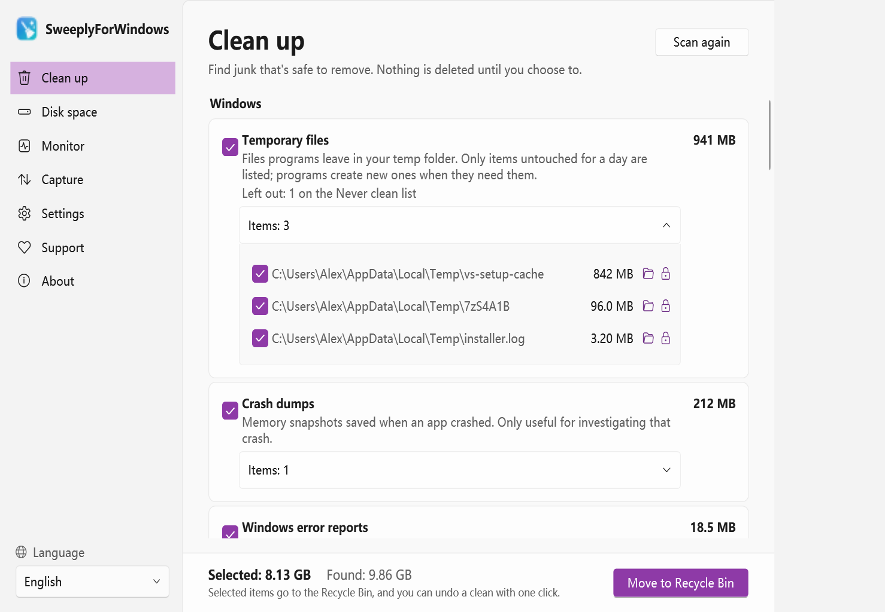
</p>

> **Status: preview (0.6).** Cleaning, undo, the "Never clean" list, the folder right-click menu,
> clean-up reminders, Clean up every day, Disk space, the Monitor page, Capture, Behavior, background
> mode and the activity monitor all work.

## What it finds

**Windows**
- Temporary files programs left behind (only items untouched for a day)
- Crash dumps and Windows error reports
- Graphics shader caches of Windows and the NVIDIA, AMD and Intel drivers

**Browsers**
- Disk caches of Microsoft Edge, Google Chrome, Firefox, Brave, Vivaldi, Opera, Yandex Browser,
  360 Browser and QQ Browser — history, passwords and sign-ins are kept

**Chat apps**
- WeChat (current and older versions) and WeCom: cache and logs; chat pictures, videos and
  received files over 6 months old, which are not selected by default. Chat history, documents
  and synced files are never touched.
- QQ, DingTalk and Feishu / Lark: the caches of their built-in browsers

**Developer tools**
- npm, pip, NuGet, Yarn, Gradle, Go and Cargo caches
- VS Code, VSCodium and Cursor: caches, old logs, crash reports and extension downloads —
  settings, extensions and workspaces are kept

**Other apps**
- Steam, Discord, Slack, Spotify, Microsoft Teams and NetEase Cloud Music: the caches of their
  built-in browsers. A folder only counts when what is inside really is a cache, not because of its name.

**Downloads**
- Installers (.exe, .msi, .msix) in your Downloads folder — not selected by default

Apps that are not on your PC are not shown. Each category explains what it is and whether it comes back. Expand it to see every item,
show it in File Explorer, or untick the ones you want to keep.

## Clean up a project folder

<p align="center">
  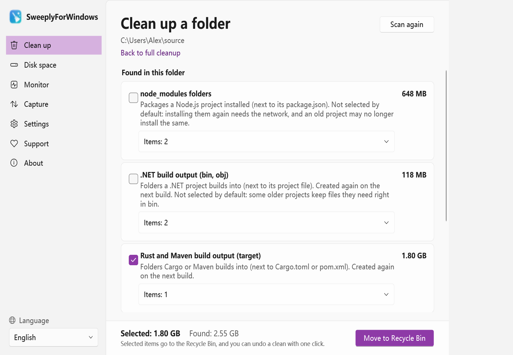
</p>

Turn on **Settings → File Explorer → Add to the folder right-click menu**, then right-click a folder
(or empty space inside one) and choose **Clean up with SweeplyForWindows**. It looks through that
folder for:

- `node_modules` next to a `package.json`
- `bin` and `obj` next to a .NET project file
- `target` next to `Cargo.toml` or `pom.xml`; `build` and `.gradle` next to `build.gradle`
- Python caches: `__pycache__`, `.pytest_cache`, `.mypy_cache`, `.ruff_cache`
- Office owner files (`~$…`), and `.tmp`, `Thumbs.db` and `.DS_Store`, untouched for a day

A build folder only counts next to the project file that creates it, so your own folder called
`build` or `bin` is never offered. `node_modules` and .NET `bin`/`obj` are not ticked by default.
Folders starting with a dot (`.git`, `.vscode`…) are never looked into, and Windows, Program Files
and app data can't be scanned at all. The same list, Recycle Bin and undo apply.
On Windows 11 the entry is under **Show more options**.

## See what takes up the space

<p align="center">
  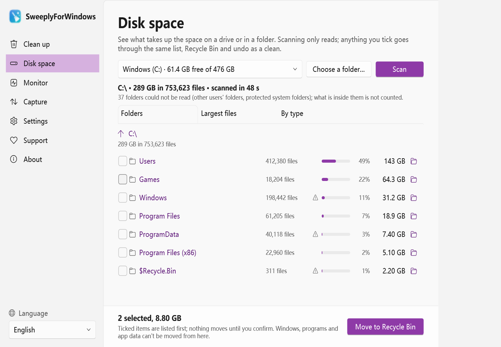
</p>

**Disk space** in the sidebar scans a whole drive or one folder — it only reads — and shows:

- folders largest first, with their share and size; click one to go in, or a folder in the path above to go back up;
- the 100 largest files, wherever they are;
- totals by type: videos, pictures, archives, disk images, programs and so on.

Folders that can't be read (other users' folders, protected system folders) are marked, and for a
whole drive it says how much of what Windows counts as used the scan could not see. Links are not followed.

Tick files or folders to move them to the Recycle Bin: the same list, check right before moving
and undo apply as for a clean. Windows, installed programs and app data can't be moved from here,
nor any folder that holds them, nor hidden system files such as pagefile.sys. Desktop, Documents,
Downloads and the other personal folders stay, though what is inside them can go.

## Watch what your PC is doing

<p align="center">
  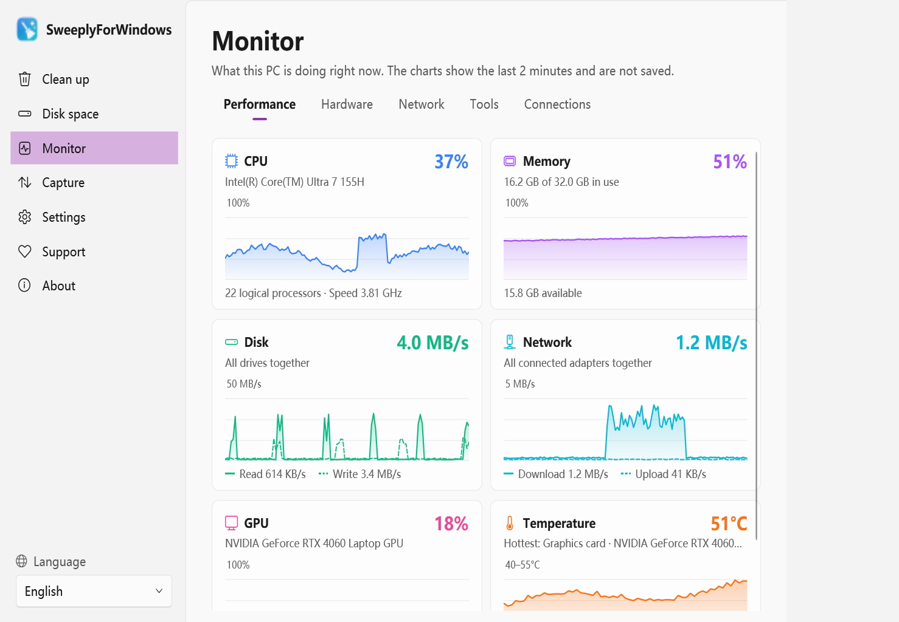
</p>

**Monitor** in the sidebar has five parts:

- **Performance:** CPU (with its speed right now), memory, disk reads and writes, download and upload,
  GPU and the hottest temperature, each with a chart of the last 2 minutes.
- **Hardware:** the temperature of every drive and graphics card that reports one; the health NVMe
  drives keep about themselves (life used, written in total, hours powered on, unsafe shutdowns, media
  errors); and what the PC is made of — model, processor with its performance and efficient cores,
  memory modules, graphics cards, drives. **Copy** puts it on the clipboard.
- **Network:** every adapter with its addresses (IPv4 and IPv6, gateway, DNS, MAC, DHCP) and, for
  Wi-Fi, the network, signal, band, channel and standard. Click a value to copy it.
- **Tools:** ping, trace route, and a scan of the local network that lists the devices on it (one
  ping per address plus Windows' own address lookup, so devices that ignore pings show up too; no
  ports are tried).
- **Connections:** every TCP and UDP connection with the program behind it (and, for svchost.exe, the
  services it runs), as TCPView shows them: new ones green for a few seconds, closed ones red, then
  gone.

<p align="center">
  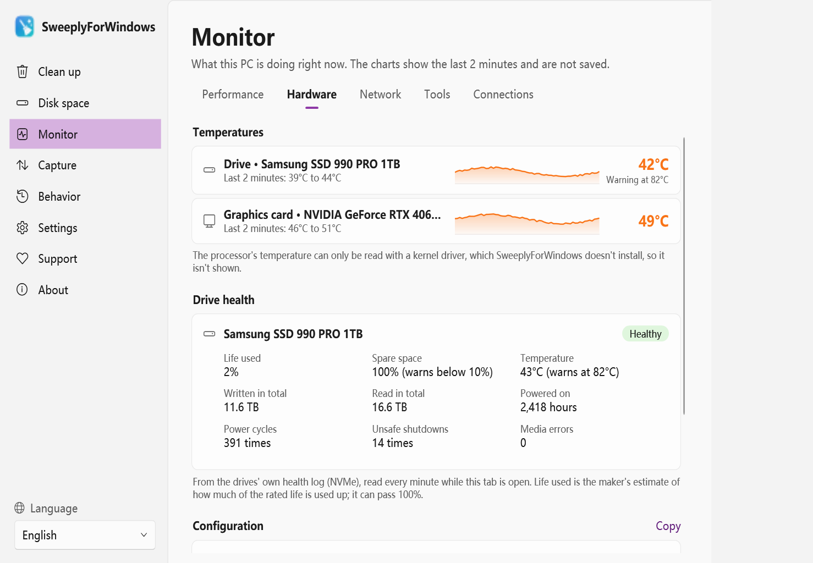
</p>

Everything is read without administrator rights or a driver, and only while the page is open. The
processor's temperature needs a kernel driver, so it isn't shown. Nothing is saved, and the tools send
packets only when you start them, only to the addresses you choose. They also say when a proxy in TUN
mode on this PC is answering in place of the real network.

## See what goes over the network

<p align="center">
  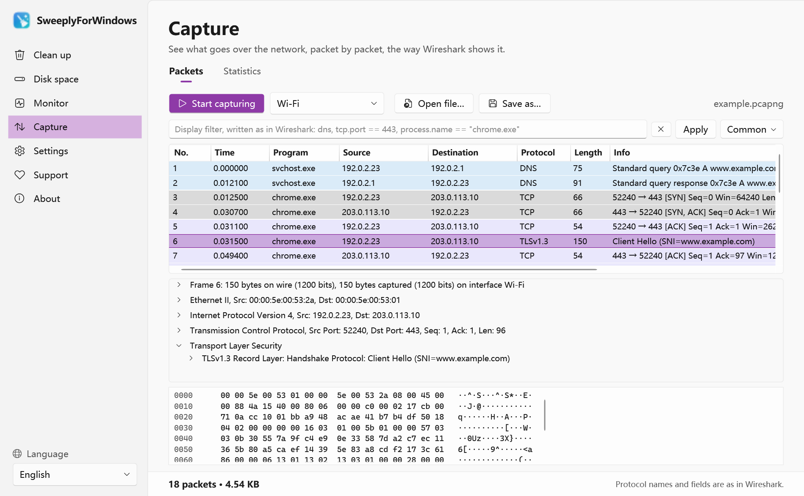
</p>

**Capture** shows network traffic packet by packet, the way Wireshark does: the list, each packet's
details as a tree (protocol names and fields as in Wireshark, so what you look up matches what you
see) and its bytes.

- **Start capturing** on one network adapter or on all of them. It uses the packet capture built into
  Windows, so there is nothing to install; with Npcap installed (Wireshark installs it), it uses Npcap
  instead. Capturing runs in a small helper, which Windows asks you to allow as administrator each time
  (it doesn't ask if your account is in the Performance Log Users group); the app itself never runs as
  administrator. Capturing goes on while other pages are open, until you stop it.
- **The program of each packet**, from the same table the Connections part of Monitor shows. Wireshark
  can't tell you that.
- **Open** .pcapng and .pcap files (or drop one on the page), and **save** as .pcapng, with the
  programs kept as packet comments, which Wireshark shows.
- **Display filters**, written as in Wireshark: `dns`, `tcp.port == 443`, `ip.addr == 192.0.2.1`,
  `http || tls`, `!arp`, and `process.name == "chrome.exe"` for a program. Right-click a field to filter
  on it, or a packet to see only its conversation.
- **Statistics:** programs, conversations, endpoints, the protocol hierarchy and trouble
  (retransmissions, resets, failed lookups…, each with what it means), and traffic over time.
  Addresses get names from the capture itself: the server name a connection asked for, or a DNS
  answer.
- **Follow stream** puts a TCP or UDP conversation back together, each end in its own colour.

<p align="center">
  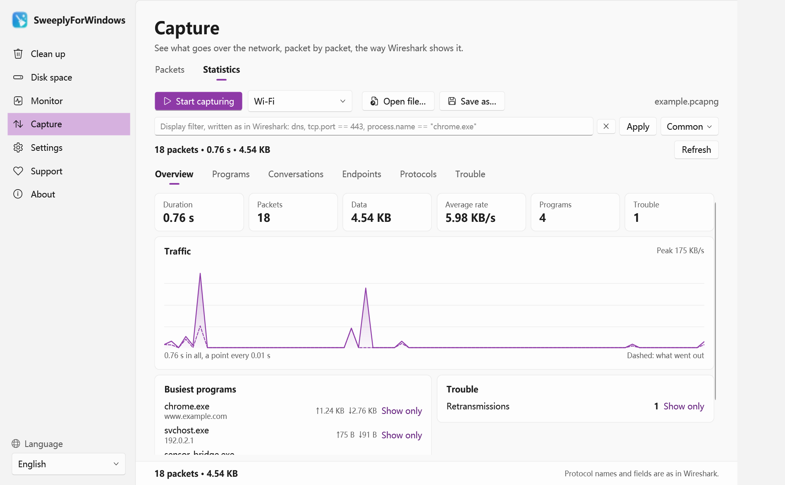
</p>

Only this PC's own traffic is captured (no promiscuous or Wi-Fi monitor mode), up to 200,000 packets
or 256 MB at a time. On Wi-Fi, Windows hands over the Wi-Fi frames themselves, already decrypted, and
they are shown as such. Without Npcap, traffic on the loopback (127.0.0.1) isn't seen. Windows'
capture doesn't reach a VPN's or a proxy's TUN adapter (where each program's own traffic goes when one
is on): there, and wherever Windows' capture can't start, raw sockets capture, which see IPv4 only and
need administrator rights (the page says so). Nothing is sent
anywhere: a capture stays on this PC unless you save it. Encrypted traffic (HTTPS) stays encrypted:
you see who talked to whom, when and how much, not what was said.

## See what a program does

<p align="center">
  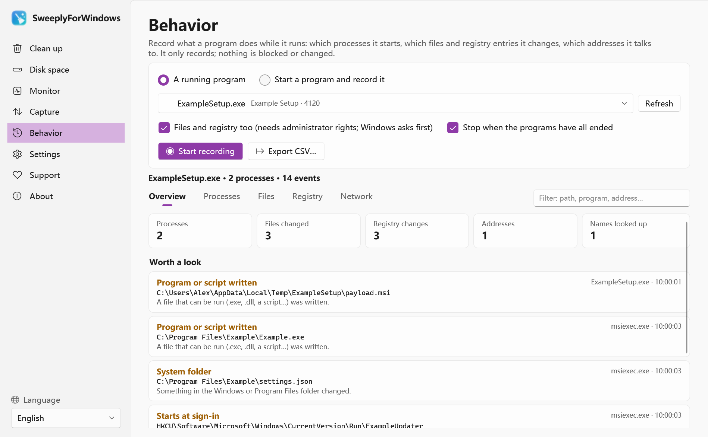
</p>

**Behavior** records what a program does while it runs: the processes it starts, the files and
registry entries it changes, and the addresses it talks to. Choose a running program, or start one
from the page so it is recorded from its first moment, then use it as usual and stop when you're done.
Whatever it starts is recorded too.

- **Overview:** how many processes, files, registry changes, addresses and names looked up, the
  folders with the most changes, and **Worth a look**: autostart entries, Startup folder items,
  services, scheduled tasks, programs written to disk, a changed hosts file and the like, each with what
  it means. These are changes worth a look, not signs of harm: installers do them all the time.
- **Processes, Files, Registry and Network** list the details, with a filter and **Export CSV**.
- From **Monitor → Connections**, right-click a connection and choose **Record this program's behavior**.

By default it records the processes, their connections and how much they read and write, without
administrator rights; the names they look up too if your account is in the Performance Log Users group. Tick **Files and registry too** to record those as well: the
recording then runs in a small helper, which Windows asks you to allow as administrator each time; the
app itself never runs as administrator. A recording stops when you stop it, when the programs have all
ended (if you choose), or after 30 minutes or 200,000 events. It only records: nothing is blocked,
changed or sent anywhere, and it doesn't tell you whether a program is safe.

## Safety first

<p align="center">
  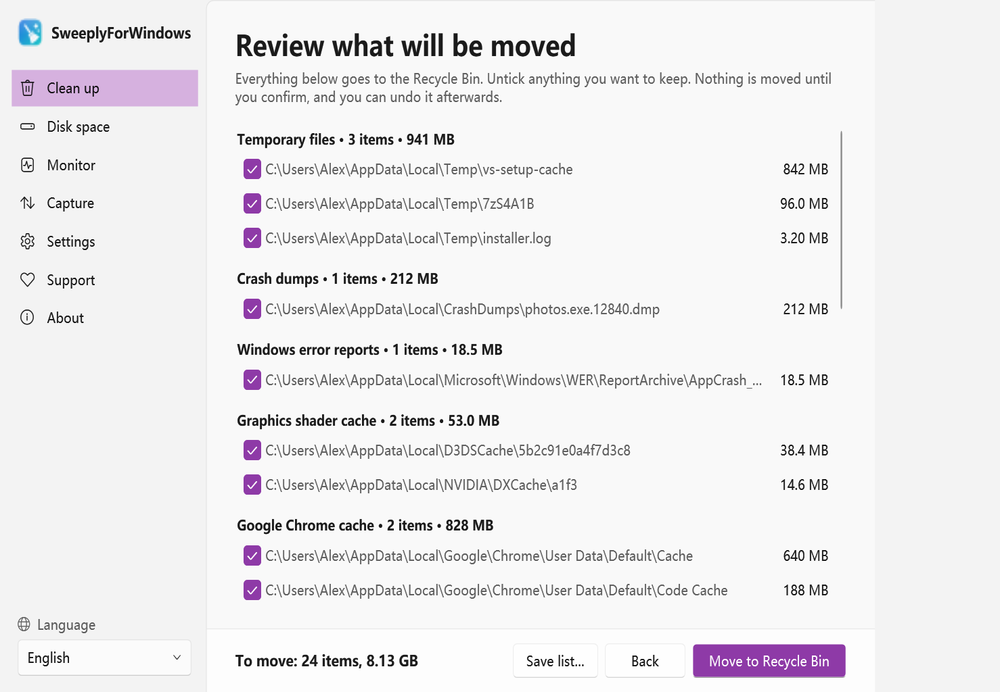
</p>

- **Nothing is moved without you.** Sweeply only scans. Before anything moves, you see the full list
  of what would go, can untick any item or save the list, and then confirm. The one exception is
  Clean up every day, if you turn it on (see below).
- **Everything goes to the Recycle Bin**, so you can restore it. If something is too big for the
  Recycle Bin, Windows asks you first instead of deleting it for good.
- **Undo.** The last 5 cleans can be undone: what was moved goes back where it was, as long as it
  is still in the Recycle Bin.
- **A "Never clean" list.** Add folders in Settings, or press the lock next to an item. Anything on
  the list, or inside it, is never offered or moved.
- **Checked twice.** Right before moving, each item is checked again: still inside its category's
  folder, not a link to somewhere else, on this PC's own disk, not on the "Never clean" list, and
  its app not running. Items that must be old enough (temporary files, old chat pictures) still have to be.
- **Only this PC's own disks.** USB sticks and network drives are never touched.
- **Apps are left alone while they're open** (browsers, WeChat), and files in use are skipped.
- **Never goes online by itself.** No analytics, no accounts. Ping, trace route and the network scan
  send packets only when you start them.

## Runs quietly in the background

<p align="center">
  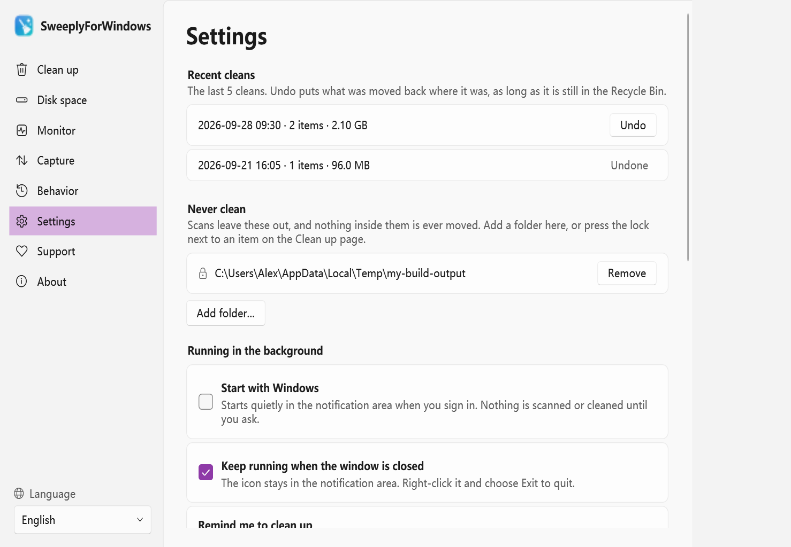
</p>

- **Stays in the notification area.** Closing the window keeps it there; right-click the icon to exit.
  You can turn this off in Settings.
- **Start with Windows** (off by default): starts as an icon only when you sign in.
  Nothing is scanned or cleaned until you ask (or turn on Clean up every day).
- **Clean-up reminder** (off by default): every week or month it looks — only reads — and shows a
  notification when at least 1 GB can be cleaned. Cleaning by hand starts the wait again.
- **Clean up every day** (off by default): once a day it moves what is ticked by default to the
  Recycle Bin, except package caches and graphics shader caches, which would only be downloaded or
  built again. Open apps and the "Never clean" list are skipped as always, and anything the Recycle
  Bin can't take is left alone. No list is shown first: a notification says what was moved, and it
  can be undone like any other clean.
- **Activity monitor**, every part optional:
  - a live number on the icon: CPU usage, download or upload speed, disk writes, or the highest temperature;
  - download and upload speed, CPU usage, disk writes and temperatures when you point at the icon;
  - a small floating bar that stays on top of other windows. Drag it anywhere; right-click it to hide it.

<p align="center">
  
</p>

The readings come from Windows itself (performance counters and network adapters) and never leave your PC.

Temperatures need no administrator rights: NVMe drives report their own (the same reading Settings
shows), other internal drives are read through Windows, and graphics cards the way Task Manager reads
them — dedicated cards usually report one, integrated graphics usually don't. The processor's
temperature can only be read with a kernel driver, which SweeplyForWindows doesn't install, so it isn't
shown. Parts that can't be read are simply left out.

## Made for Windows

<p align="center">
  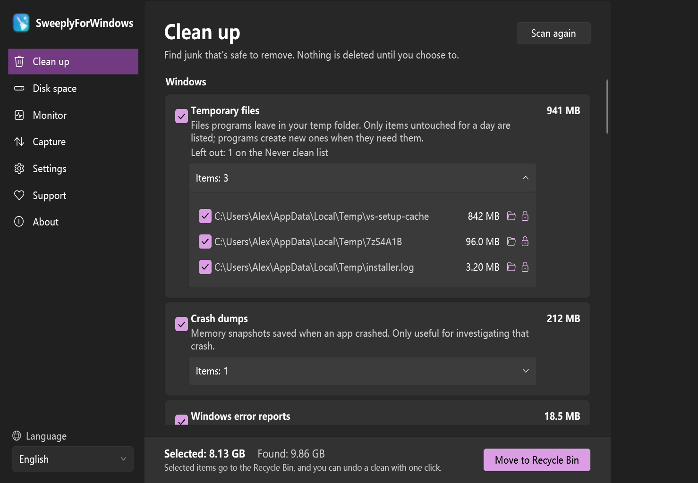
</p>

- Windows 11 Fluent look that follows your light / dark theme and accent colour.
- Progress in the window and on the taskbar button while scanning and cleaning.
- Finds your Downloads folder even if you moved it to another drive.
- 7 languages, switch any time from the sidebar — no restart needed:
  English, 简体中文, 繁體中文, 日本語, Русский, Español, हिन्दी.
  Translations other than English and Chinese would love a review from native speakers.

## Install

1. Download `SweeplyForWindows-<version>-win-x64.zip` from [Releases](../../releases).
2. Unzip it anywhere and run `SweeplyForWindows.exe`. Nothing to install, no .NET needed.
3. Windows SmartScreen may say the app is unrecognised, because it isn't code-signed yet.
   Click **More info → Run anyway**.

Requires 64-bit Windows 10 or 11.

## Build from source

Requires the .NET 9 SDK.

```powershell
dotnet build
dotnet test
powershell -ExecutionPolicy Bypass -File tools\release.ps1   # zip in artifacts\
```

- `SweeplyForWindows.exe --snapshot <folder>` renders every page with made-up results, in every
  language, light and dark — without capturing the screen. That's how the screenshots here are made.
- `SweeplyForWindows.exe --scan-report <file>` scans read-only and writes each category's status,
  item count and size, without any paths — handy to attach to a bug report.

## Support SweeplyForWindows

SweeplyForWindows is free and always will be. If it saved you some space or some time,
you can buy the developer a coffee — WeChat Pay or Alipay in China, PayPal anywhere.
Every coffee keeps the project going. Thank you!

<table align="center">
  <tr>
    <th>WeChat Pay</th>
    <th>Alipay</th>
    <th>PayPal</th>
  </tr>
  <tr>
    <td></td>
    <td></td>
    <td></td>
  </tr>
</table>

Not in a position to donate? A ⭐ on this repo, a bug report or a translation fix helps just as much.

## Contact

Bugs and ideas: [open an issue](../../issues).

## License

[MIT](LICENSE)
